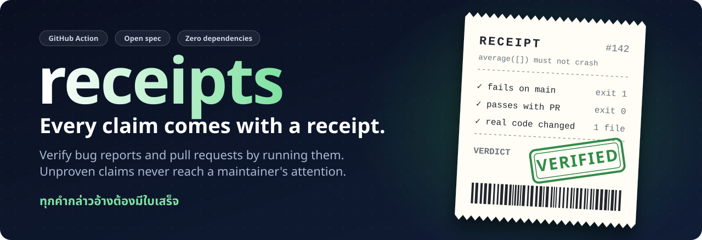
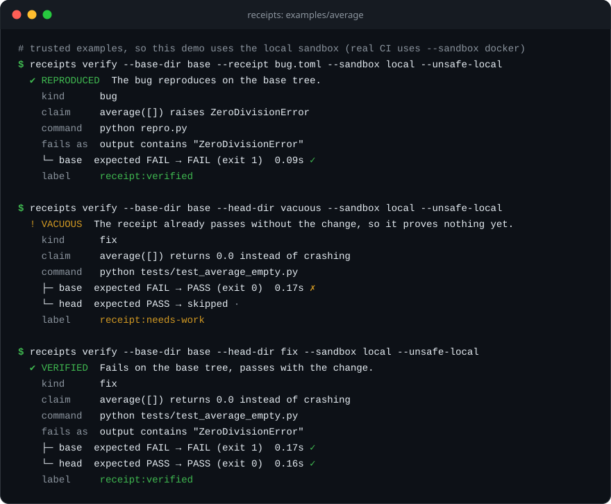
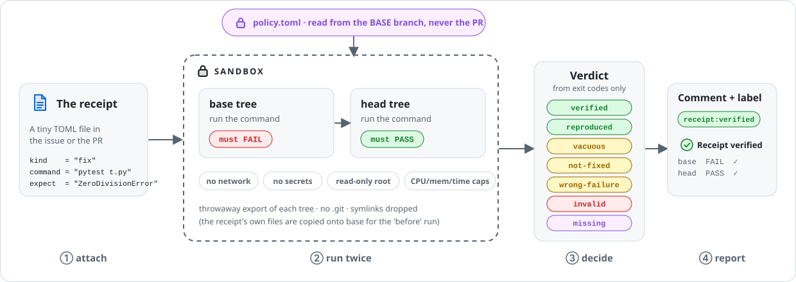
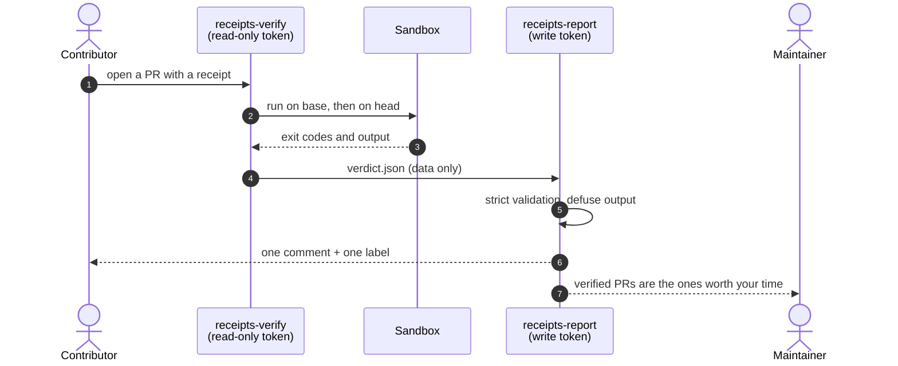
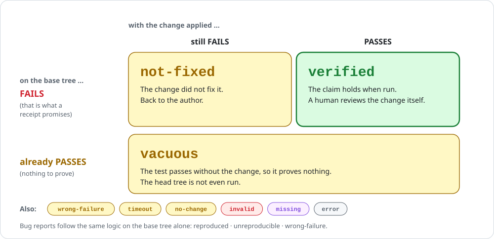
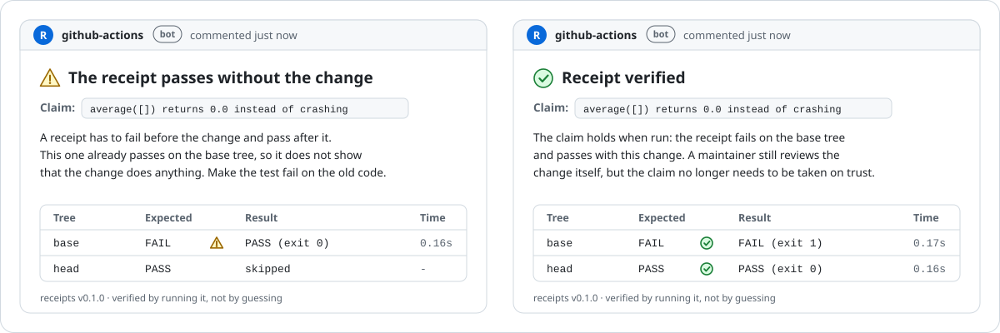

<div align="center">



<br>

[](https://github.com/SUTTIPATTESTER/receipts/actions/workflows/ci.yml)


**English** · [ภาษาไทย](README.th.md)

</div>

> **receipts** is an open spec and a GitHub Action that verifies bug reports and pull requests by *running* them.
> A report has to reproduce. A fix has to flip a test from red to green. Anything that cannot prove itself waits politely,
> and never costs a maintainer a minute.

## Why now

Open-source maintainers are being flooded with plausible-looking submissions that nobody has actually run:

- curl [shut down its bug bounty](https://www.theregister.com/2026/01/21/curl_ends_bug_bounty/) in January 2026 because AI-generated junk reports were overwhelming a very small security team.
- Godot's maintainers [described](https://infoq.com/news/2026/02/ai-floods-close-projects) the wave of AI-generated pull requests as draining and demoralizing.
- GitHub itself was [reportedly weighing](https://www.opensourceforu.com/2026/02/github-weighs-pull-request-kill-switch-as-ai-slop-floods-open-source/) ways to restrict or even disable pull requests.

The usual answers are bans, auto-closing and AI-detectors. They punish good contributors and don't work (you cannot reliably tell who typed a patch).
**receipts changes the question from "who wrote this?" to "does it run?"**
Contributors who use AI *and* check their work get a fast lane. Everything else is parked automatically.

## See it work

The terminal below is a **real capture** of `receipts verify` against [`examples/average`](examples/average), produced by
[`docs/tools/make_images.py`](docs/tools/make_images.py).



## How it works

<picture>
  <source media="(prefers-color-scheme: dark)" srcset="docs/img/flow-dark.svg">
  
</picture>

A **receipt** is a tiny TOML file. For a bug report it is a self-contained reproduction; for a pull request it points at a test:

```toml
version = 1
kind    = "fix"
title   = "average([]) returns 0.0 instead of crashing"

[run]
command = "python tests/test_average_empty.py"   # exits non-zero while the claim is false
overlay = ["tests/test_average_empty.py"]         # the PR's test is copied onto base for the "before" run

[expect]
fail_output_contains = "ZeroDivisionError"        # it must fail the way you say it fails
```

1. **Run on the base tree.** It must fail, and with the promised signature. Otherwise the receipt is `vacuous` or `wrong-failure`.
2. **Run on the head tree.** It must pass. Otherwise the change is `not-fixed`.
3. **Decide from exit codes.** No language model sits in the verdict path, so it is cheap, repeatable and impossible to sweet-talk.



### The verdicts

<picture>
  <source media="(prefers-color-scheme: dark)" srcset="docs/img/verdicts-dark.svg">
  
</picture>

### What contributors see

Feedback is specific and never accusatory. (Illustrative rendering of the real comment text.)

<picture>
  <source media="(prefers-color-scheme: dark)" srcset="docs/img/comments-dark.svg">
  
</picture>

## Try it in two minutes

You only need Python 3.11+ (standard library only, nothing to install).

```bash
git clone https://github.com/SUTTIPATTESTER/receipts && cd receipts
export PYTHONPATH=src            # PowerShell: $env:PYTHONPATH = "$PWD\src"

# 1. a bug report that reproduces
python -m receipts verify --base-dir examples/average/base --receipt examples/average/bug.toml \
    --sandbox local --unsafe-local

# 2. a "fix" whose test already passes without the fix  ->  VACUOUS
python -m receipts verify --base-dir examples/average/base --head-dir examples/average/vacuous \
    --sandbox local --unsafe-local

# 3. a real fix  ->  VERIFIED
python -m receipts verify --base-dir examples/average/base --head-dir examples/average/fix \
    --sandbox local --unsafe-local
```

`--sandbox local` is **not a security boundary**; that is why it needs `--unsafe-local`. Use it only on code you trust, like these examples.
For anything from strangers the default is `--sandbox docker`.

Write your own receipt:

```bash
python -m receipts init --kind bug .receipts/my-bug.toml     # or --kind fix
python -m receipts lint .receipts/my-bug.toml
```

It works with any language: the command runs inside the image from your policy, so `npm test`, `cargo test` or `go test ./...` are all fair game.

## Add it to your repository

Copy three files from [`examples/workflows`](examples/workflows) into `.github/workflows/` (pin the `uses:` lines to a commit SHA in production):

| file | runs | token |
|---|---|---|
| `receipts-verify-pr.yml` | untrusted PR code, **inside the sandbox** | `contents: read`, no secrets |
| `receipts-verify-issue.yml` | the ```` ```toml receipt ```` block of a bug report | `contents: read`, no secrets |
| `receipts-report.yml` | nothing from the PR: validates a data artifact, then comments and labels | write, **never touches PR code** |

Optionally add [`.receipts/policy.toml`](examples/workflows/policy.toml) on your default branch to set the image, time and memory limits.
Policy is always read from the **base** branch, so a PR cannot loosen its own rules.

> **Status: alpha.** The verifier, sandbox argv, parsing and report hardening are covered by unit tests and a benchmark
> (see below), and CI exercises the Docker sandbox end to end. The two composite actions and the verify/report workflow pair are new and
> have not yet been run end to end on a live repository: try them on a scratch repo first, and please open an issue with what you find.

## Security: claims come from the PR, rules never do

<picture>
  <source media="(prefers-color-scheme: dark)" srcset="docs/img/trust-dark.svg">
  
</picture>

- **Two workflows, one-way flow.** The workflow that runs contributor code has no write token; the one with the token never runs contributor code.
- **Sandboxed execution:** no network, no capabilities, read-only root, CPU/memory/pid/time/output limits, throwaway exports with no `.git` and no symlinks.
- **Strict parsing:** unknown keys, `..` or absolute paths, protected locations (`.github/`, `.git/`), oversized files and non-integer timeouts are rejected.
- **Hostile output is defanged:** `@mentions` are neutralised, code fences cannot be closed from inside, ANSI and control characters are stripped.
- **Forged verdicts are rejected** by a strict schema before any token is used.
- **Anti-cheat rules:** a bug receipt must name its failure signature and the command may not echo it; a PR that changes nothing but its receipt is `no-change`.

### Honest limits

A `verified` verdict proves a command flipped from failing to passing and that the PR touched more than its own receipt. **It does not prove the command measures what the title claims.**
A human still reviews the change; receipts only makes sure that human's time goes to claims that already survived contact with a computer.
The benchmark contains two such cases on purpose. Read the full [threat model](docs/threat-model.md), including what Docker does and doesn't give you.

## Benchmark

`python -m receipts bench` replays 19 hand-built cases through the real verifier and checks each verdict against the spec.

<details>
<summary>Output</summary>

```text
case                      expected        got
------------------------------------------------------------
bug-command-not-found     invalid         invalid         ✓
bug-malformed-toml        invalid         invalid         ✓
bug-missing-signature     invalid         invalid         ✓
bug-protected-path        invalid         invalid         ✓
bug-reproduced            reproduced      reproduced      ✓
bug-signature-in-command  invalid         invalid         ✓
bug-unreproducible        unreproducible  unreproducible  ✓
bug-wrong-failure         wrong-failure   wrong-failure   ✓
fix-invalid-traversal     invalid         invalid         ✓
fix-missing               missing         missing         ✓
fix-no-change             no-change       no-change       ✓
fix-not-fixed             not-fixed       not-fixed       ✓
fix-overlay-missing       invalid         invalid         ✓
fix-timeout               timeout         timeout         ✓
fix-trivial-file-exists   verified        verified        ✓  (known limitation)
fix-unrelated-flip        verified        verified        ✓  (known limitation)
fix-vacuous               vacuous         vacuous         ✓
fix-verified              verified        verified        ✓
fix-wrong-failure         wrong-failure   wrong-failure   ✓

19/19 cases behave as specified.
2 accepted receipt(s) are known limitations (they satisfy the spec but a human would call them meaningless).
```

</details>

This is a **conformance suite**, not an accuracy claim: the cases are synthetic and chosen by the authors.
The next milestone is a replay dataset built from real historical issues and pull requests (see the roadmap).

## FAQ

**Doesn't this punish people who use AI?** No. It is deliberately blind to *who* wrote something. A contributor who uses an AI tool and checks that the receipt really fails and then passes gets verified like anyone else.

**Why not detect AI-generated text?** Detectors are unreliable and accuse real people. Running code is the one test that is the same for everybody.

**Which languages are supported?** Any language with a command that exits non-zero on failure. The tool itself is Python (3.11+, standard library only), the code it verifies can be anything the policy image can run.

**What if the receipt is gamed?** Some can be: see [Honest limits](#honest-limits). The design goal is to make cheating cost more than doing the work, and to keep a human in charge of meaning.

**Does it need an API key or a model?** No. There is no model in the verdict path.

## Roadmap

- [ ] Diff-coverage: require that the receipt actually executes the changed lines (closes the gap behind both known limitations)
- [ ] Mutation sanity check: revert the change hunk by hunk and confirm the receipt notices
- [ ] A replay dataset from real historical issues and pull requests, with precision and recall published
- [ ] Per-language starter images and policy presets (Node, Rust, Go, Java)
- [ ] gVisor / Firecracker runner option for high-risk repositories
- [ ] A GitHub App so adopting it needs no workflow files
- [ ] Forgejo / GitLab adapters

## Repository map

```text
spec/RECEIPT.md        the open format
src/receipts/          the reference implementation (standard library only)
action.yml             composite Action: verify (unprivileged)
report/action.yml      composite Action: report (privileged, never runs PR code)
examples/              runnable examples and drop-in workflows
bench/cases/           conformance cases, including known limitations
docs/threat-model.md   what is defended, how, and what is not
docs/tools/            regenerates every image in this README from real output
tests/                 unit and end-to-end tests
```

## Contributing

Bring a receipt. See [CONTRIBUTING.md](CONTRIBUTING.md). Security issues: [SECURITY.md](SECURITY.md). [MIT licensed](LICENSE).
