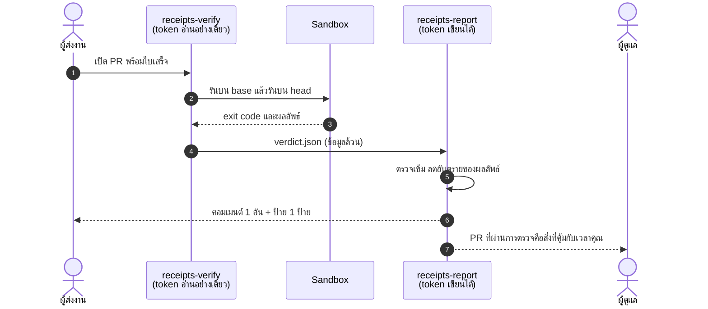

<div align="center">


<br>

[](https://github.com/SUTTIPATTESTER/receipts/actions/workflows/ci.yml)


[English](README.md) · **ภาษาไทย**

</div>

> **receipts** คือสเปกเปิดและ GitHub Action ที่ตรวจ bug report และ pull request ด้วยการ *รันจริง*
> รายงานบั๊กต้องทำซ้ำได้ การแก้ไขต้องทำให้เทสต์เปลี่ยนจากแดงเป็นเขียว สิ่งไหนพิสูจน์ตัวเองไม่ได้จะถูกพักไว้อย่างสุภาพ
> และไม่กินเวลาผู้ดูแลแม้แต่นาทีเดียว

## ทำไมต้องตอนนี้

ผู้ดูแลโอเพนซอร์สกำลังถูกท่วมด้วยงานที่ดูน่าเชื่อถือแต่ไม่มีใครเคยรันดูจริง

- curl [ปิดโครงการ bug bounty](https://www.theregister.com/2026/01/21/curl_ends_bug_bounty/) เมื่อเดือนมกราคม 2026 เพราะรายงานขยะที่สร้างด้วย AI ท่วมทีมความปลอดภัยที่มีคนน้อยมาก
- ผู้ดูแล Godot [อธิบาย](https://infoq.com/news/2026/02/ai-floods-close-projects) ว่าคลื่น pull request จาก AI ทั้งเหนื่อยและบั่นทอนกำลังใจ
- GitHub เองก็[มีรายงานว่ากำลังพิจารณา](https://www.opensourceforu.com/2026/02/github-weighs-pull-request-kill-switch-as-ai-slop-floods-open-source/) วิธีจำกัดหรือแม้แต่ปิดระบบ pull request

คำตอบที่พบบ่อยคือแบน ปิดอัตโนมัติ หรือใช้ตัวตรวจจับ AI ซึ่งลงโทษคนที่ตั้งใจดีด้วย และใช้ไม่ได้ผลจริง (ไม่มีใครบอกได้แน่ว่าใครเป็นคนพิมพ์แพตช์)
**receipts เปลี่ยนคำถามจาก "ใครเขียน" เป็น "มันรันได้ไหม"**
คนที่ใช้ AI *และ* ตรวจงานตัวเองจะได้ช่องทางด่วน ที่เหลือถูกพักไว้โดยอัตโนมัติ

## ดูของจริง

ภาพ terminal ด้านล่างเป็น **ภาพที่จับจากการรันจริง** ของ `receipts verify` กับ [`examples/average`](examples/average)
สร้างโดย [`docs/tools/make_images.py`](docs/tools/make_images.py)


## ทำงานอย่างไร

<picture>
  <source media="(prefers-color-scheme: dark)" srcset="docs/img/flow-dark.svg">
  
</picture>

**ใบเสร็จ (receipt)** คือไฟล์ TOML เล็กๆ สำหรับ bug report คือโค้ดทำซ้ำบั๊กที่ครบในตัว ส่วน pull request ชี้ไปที่เทสต์:

```toml
version = 1
kind    = "fix"
title   = "average([]) returns 0.0 instead of crashing"

[run]
command = "python tests/test_average_empty.py"   # exit ไม่เป็นศูนย์ตราบใดที่คำกล่าวอ้างยังเป็นเท็จ
overlay = ["tests/test_average_empty.py"]         # เทสต์ของ PR ถูกคัดลอกไปรันบน base ในรอบ "ก่อนแก้"

[expect]
fail_output_contains = "ZeroDivisionError"        # ต้องล้มด้วยอาการที่คุณบอกไว้
```

1. **รันบน base** ต้องล้ม และล้มด้วยลายเซ็นที่สัญญาไว้ ไม่เช่นนั้นเป็น `vacuous` หรือ `wrong-failure`
2. **รันบน head** ต้องผ่าน ไม่เช่นนั้นเป็น `not-fixed`
3. **ตัดสินจาก exit code** ไม่มีโมเดลภาษาอยู่ในเส้นทางตัดสิน จึงถูก ทำซ้ำได้ และโน้มน้าวไม่ได้



### ผลการตัดสิน

<picture>
  <source media="(prefers-color-scheme: dark)" srcset="docs/img/verdicts-dark.svg">
  
</picture>

### ผู้ส่งงานเห็นอะไร

ข้อเสนอแนะเฉพาะเจาะจงและไม่กล่าวหา (ภาพประกอบจากข้อความคอมเมนต์จริง)

<picture>
  <source media="(prefers-color-scheme: dark)" srcset="docs/img/comments-dark.svg">
  
</picture>

## ลองได้ใน 2 นาที

ต้องมีแค่ Python 3.11 ขึ้นไป (ใช้ไลบรารีมาตรฐานล้วน ไม่ต้องติดตั้งอะไรเพิ่ม)

```bash
git clone https://github.com/SUTTIPATTESTER/receipts && cd receipts
export PYTHONPATH=src            # PowerShell: $env:PYTHONPATH = "$PWD\src"

# 1. bug report ที่ทำซ้ำได้
python -m receipts verify --base-dir examples/average/base --receipt examples/average/bug.toml \
    --sandbox local --unsafe-local

# 2. "การแก้ไข" ที่เทสต์ผ่านอยู่แล้วโดยไม่ต้องแก้  ->  VACUOUS
python -m receipts verify --base-dir examples/average/base --head-dir examples/average/vacuous \
    --sandbox local --unsafe-local

# 3. การแก้ไขจริง  ->  VERIFIED
python -m receipts verify --base-dir examples/average/base --head-dir examples/average/fix \
    --sandbox local --unsafe-local
```

`--sandbox local` **ไม่ใช่เส้นแบ่งความปลอดภัย** จึงต้องใส่ `--unsafe-local` ใช้กับโค้ดที่ไว้ใจได้เท่านั้น เช่นตัวอย่างเหล่านี้
ส่วนงานจากคนแปลกหน้าให้ใช้ค่าเริ่มต้นคือ `--sandbox docker`

เขียนใบเสร็จของคุณเอง:

```bash
python -m receipts init --kind bug .receipts/my-bug.toml     # หรือ --kind fix
python -m receipts lint .receipts/my-bug.toml
```

ใช้ได้กับทุกภาษา เพราะคำสั่งรันอยู่ใน image ตามนโยบายของคุณ `npm test`, `cargo test` หรือ `go test ./...` ใช้ได้หมด

## ใส่ใน repo ของคุณ

คัดลอก 3 ไฟล์จาก [`examples/workflows`](examples/workflows) ไปที่ `.github/workflows/` (ปักบรรทัด `uses:` ด้วย commit SHA ตอนใช้งานจริง)

| ไฟล์ | รันอะไร | token |
|---|---|---|
| `receipts-verify-pr.yml` | โค้ด PR ที่ไม่น่าไว้ใจ **ภายใน sandbox** | `contents: read` ไม่มี secret |
| `receipts-verify-issue.yml` | บล็อก ```` ```toml receipt ```` ใน bug report | `contents: read` ไม่มี secret |
| `receipts-report.yml` | ไม่รันอะไรจาก PR: ตรวจไฟล์ข้อมูล แล้วคอมเมนต์และติดป้าย | เขียนได้ แต่ **ไม่แตะโค้ด PR เลย** |

เพิ่ม [`.receipts/policy.toml`](examples/workflows/policy.toml) ที่ default branch ได้ถ้าต้องการกำหนด image, เวลา และหน่วยความจำ
นโยบายถูกอ่านจาก **base branch** เสมอ PR จึงผ่อนกฎของตัวเองไม่ได้

> **สถานะ: alpha** ตัวตรวจสอบ, argv ของ sandbox, การ parse และการลดอันตรายของรายงานมี unit test กับ benchmark ครอบคลุม (ดูด้านล่าง)
> และ CI ทดสอบ Docker sandbox แบบ end to end ส่วน composite action ทั้งสองและคู่ workflow verify/report เป็นของใหม่
> ที่ยังไม่เคยรันครบวงจรบน repo จริง ขอให้ลองบน repo ทดสอบก่อน และเปิด issue บอกสิ่งที่พบ

## ความปลอดภัย: คำกล่าวอ้างมาจาก PR แต่กฎไม่เคยมาจาก PR

<picture>
  <source media="(prefers-color-scheme: dark)" srcset="docs/img/trust-dark.svg">
  
</picture>

- **สอง workflow ข้อมูลไหลทางเดียว** workflow ที่รันโค้ดผู้ส่งไม่มี token เขียน ส่วนอันที่มี token ไม่เคยรันโค้ดผู้ส่ง
- **รันใน sandbox:** ไม่มีเน็ตเวิร์ก ไม่มี capability root อ่านอย่างเดียว จำกัด CPU/หน่วยความจำ/process/เวลา/ขนาดผลลัพธ์ และ export ต้นไม้ไฟล์แบบใช้แล้วทิ้ง ไม่มี `.git` และไม่มี symlink
- **parse เข้มงวด:** ปฏิเสธคีย์ที่ไม่รู้จัก path แบบ `..` หรือ absolute ตำแหน่งที่ป้องกันไว้ (`.github/`, `.git/`) ไฟล์ใหญ่เกิน และ timeout ที่ไม่ใช่จำนวนเต็ม
- **ผลลัพธ์อันตรายถูกลดพิษ:** `@mention` ถูกทำให้ไม่แจ้งเตือนใคร ปิด code fence จากข้างในไม่ได้ และตัด ANSI กับอักขระควบคุมออก
- **verdict ปลอมถูกปฏิเสธ** ด้วย schema เข้มงวดก่อนที่ token จะถูกใช้
- **กฎกันโกง:** ใบเสร็จของบั๊กต้องระบุลายเซ็นของอาการล้ม และคำสั่งห้ามพิมพ์ลายเซ็นนั้นเอง PR ที่เปลี่ยนแค่ใบเสร็จของตัวเองจะได้ `no-change`

### ขีดจำกัดตามจริง

ผล `verified` พิสูจน์ว่าคำสั่งหนึ่งเปลี่ยนจากล้มเป็นผ่าน และ PR แตะมากกว่าใบเสร็จของตัวเอง **แต่ไม่ได้พิสูจน์ว่าคำสั่งนั้นวัดสิ่งที่หัวข้อกล่าวอ้าง**
มนุษย์ยังต้องรีวิวการเปลี่ยนแปลง receipts แค่ทำให้เวลาของคนนั้นไปตกกับสิ่งที่ผ่านการพิสูจน์กับคอมพิวเตอร์มาแล้ว
benchmark ใส่เคสแบบนี้ไว้ 2 เคสโดยตั้งใจ อ่าน[โมเดลภัยคุกคาม](docs/threat-model.md)ฉบับเต็มได้ รวมถึงสิ่งที่ Docker ให้และไม่ให้

## Benchmark

`python -m receipts bench` เล่น 19 เคสที่สร้างด้วยมือผ่านตัวตรวจสอบจริง แล้วเทียบผลแต่ละเคสกับสเปก

เคสเหล่านี้เป็น **ชุดทดสอบความสอดคล้องกับสเปก** ไม่ใช่การอ้างความแม่นยำ: เคสเป็นของสังเคราะห์และผู้เขียนเลือกเอง
ก้าวต่อไปคือชุดข้อมูล replay จาก issue และ pull request จริงในอดีต (ดู roadmap)

ผลลัพธ์ฉบับเต็มดูได้ใน[ส่วน Benchmark ของ README ภาษาอังกฤษ](README.md#benchmark)

## คำถามที่พบบ่อย

**ลงโทษคนใช้ AI หรือเปล่า?** ไม่ ระบบตั้งใจไม่สนว่า *ใคร* เขียน ผู้ที่ใช้เครื่องมือ AI แล้วตรวจว่าใบเสร็จล้มจริงและผ่านจริง ก็ได้รับการยืนยันเหมือนคนอื่น

**ทำไมไม่ตรวจจับข้อความที่ AI สร้าง?** ตัวตรวจจับไม่น่าเชื่อถือและกล่าวหาคนจริงๆ การรันโค้ดคือการทดสอบเดียวที่ปฏิบัติต่อทุกคนเหมือนกัน

**รองรับภาษาอะไร?** ภาษาใดก็ได้ที่มีคำสั่งซึ่ง exit ไม่เป็นศูนย์เมื่อล้ม ตัวเครื่องมือเขียนด้วย Python (3.11+ ไลบรารีมาตรฐานล้วน) แต่โค้ดที่ตรวจเป็นอะไรก็ได้ที่ image ตามนโยบายรันได้

**ถ้ามีคนโกงใบเสร็จล่ะ?** บางแบบทำได้ ดู[ขีดจำกัดตามจริง](#ขีดจำกัดตามจริง) เป้าหมายคือทำให้การโกงแพงกว่าการทำงานจริง และให้มนุษย์ยังเป็นผู้ตัดสินความหมาย

**ต้องใช้ API key หรือโมเดลไหม?** ไม่ต้อง ไม่มีโมเดลอยู่ในเส้นทางตัดสิน

## Roadmap

- [ ] Diff-coverage: บังคับให้ใบเสร็จรันบรรทัดที่ถูกแก้จริง (ปิดช่องโหว่ที่อยู่เบื้องหลังข้อจำกัดทั้งสองข้อ)
- [ ] ตรวจด้วย mutation: ย้อนการแก้ทีละ hunk แล้วดูว่าใบเสร็จจับได้ไหม
- [ ] ชุดข้อมูล replay จาก issue และ pull request จริง พร้อมเผยแพร่ precision และ recall
- [ ] image และ policy เริ่มต้นแยกตามภาษา (Node, Rust, Go, Java)
- [ ] ตัวเลือก runner แบบ gVisor / Firecracker สำหรับ repo ความเสี่ยงสูง
- [ ] GitHub App เพื่อให้ใช้ได้โดยไม่ต้องมีไฟล์ workflow
- [ ] ตัวเชื่อม Forgejo / GitLab

## แผนผังของ repo

```text
spec/RECEIPT.md        รูปแบบไฟล์ที่เป็นสเปกเปิด
src/receipts/          ตัวต้นแบบ (ไลบรารีมาตรฐานล้วน)
action.yml             composite Action: verify (ไม่มีสิทธิ์พิเศษ)
report/action.yml      composite Action: report (มีสิทธิ์ แต่ไม่เคยรันโค้ด PR)
examples/              ตัวอย่างที่รันได้และ workflow สำเร็จรูป
bench/cases/           เคสทดสอบความสอดคล้อง รวมข้อจำกัดที่รู้อยู่แล้ว
docs/threat-model.md   สิ่งที่ป้องกัน วิธีป้องกัน และสิ่งที่ไม่ได้ป้องกัน
docs/tools/            สร้างภาพทุกภาพใน README นี้ใหม่จากผลลัพธ์จริง
tests/                 unit test และ end-to-end test
```

## ร่วมพัฒนา

เอาใบเสร็จมาด้วย ดู [CONTRIBUTING.md](CONTRIBUTING.md) เรื่องช่องโหว่ความปลอดภัยดู [SECURITY.md](SECURITY.md) ใช้สัญญาอนุญาต [MIT](LICENSE)
