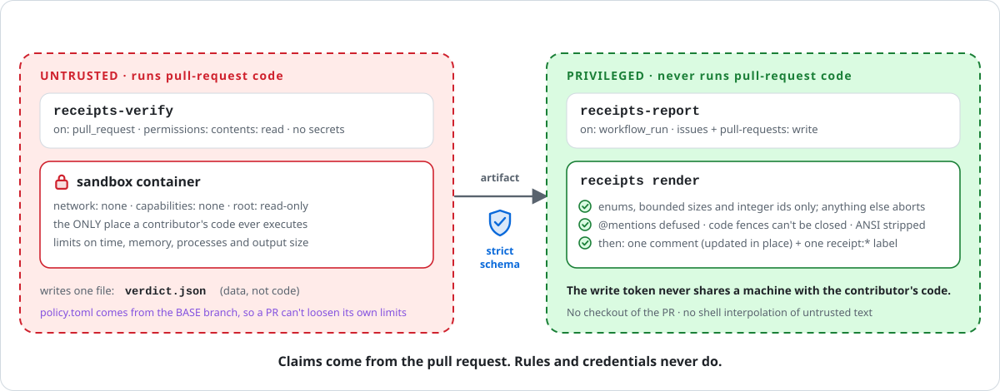

# Threat model

receipts executes commands written by people you have never met. This page says what it defends against,
how, and where the limits are. Please read it before enabling the Action on a repository you care about.

## Actors and assets

| actor / asset | trust |
|---|---|
| Maintainers, `.receipts/policy.toml` on the **base** branch | trusted |
| The receipt, the pull-request tree, the issue text | **untrusted** |
| The command's output | **untrusted** (it is attacker-controlled text that gets posted publicly) |
| Your write-scoped `GITHUB_TOKEN`, repository secrets | must never be reachable from untrusted code |

## Design: claims come from the PR, rules come from the base

<picture>
  <source media="(prefers-color-scheme: dark)" srcset="img/trust-dark.svg">
  
</picture>

1. **Two workflows, one-way data flow.** `receipts-verify` runs with `contents: read` and no secrets; it is the only place
   untrusted code executes (inside the sandbox). It hands over a single artifact, `verdict.json`.
   `receipts-report` has the write token but **never checks out or runs PR code**; it only validates and renders that artifact.
   This is the `workflow_run` pattern GitHub recommends for exactly this situation.
2. **Policy from the base branch.** Image, memory, timeout caps and the optional `setup` command are read from the base tree.
   A pull request that edits `.receipts/policy.toml` is ignored (and `.receipts/policy.toml` is not an allowed receipt path).
3. **Sandbox.** Docker with `--network none`, `--cap-drop ALL`, `no-new-privileges`, `--read-only` root, pid/memory/CPU limits,
   a scratch `/tmp`, a fixed small environment, and a throwaway export of the tree (no `.git`, no hooks, no symlinks).
4. **Strict parsing.** Unknown keys, absolute or `..` paths, protected locations (`.git/`, `.github/`), oversize files,
   control characters and non-integer timeouts are all rejected. Git refs and image names are validated before they reach a command line.
5. **Hostile output is defanged.** Output and titles only appear inside code spans/blocks. The fence is always longer than any
   backtick run inside, ANSI and control characters are stripped, and `@mentions` get a zero-width space so nobody is pinged.
6. **Forged verdicts are rejected.** `receipts render` rebuilds the verdict from a strict schema: enums, bounded lengths,
   integer subject numbers. Anything else aborts the job before a token is used.
7. **No shell interpolation of untrusted text.** Workflows pass issue bodies and refs through `env:` and files,
   never through `${{ }}` inside `run:`. Every third-party Action is pinned to a commit SHA.

## What receipts does not do

Being honest about the gaps is part of the design.

* **A passing receipt can still be meaningless.** `verified` proves a command flipped from fail to pass and that the PR changed
  more than its receipt; it cannot prove the command measures the claimed behaviour. The benchmark includes two such
  cases (`fix-trivial-file-exists`, `fix-unrelated-flip`) so the limitation is measured, not hidden. A human still reviews the change.
  Planned mitigations: diff-coverage (does the receipt execute the changed lines?) and mutation sanity checks.
* **Containers are not a perfect boundary.** Docker reduces risk; it does not make a kernel exploit impossible.
  For high-risk repositories run the verifier on ephemeral runners, or use gVisor/Kata/Firecracker as the container runtime.
* **`setup` runs with network access** and executes content from the tree being tested (for example an install script).
  It has no secrets, but it can reach the internet. Prefer a prebuilt `image`, or lockfile-only installs with scripts disabled.
* **Resource abuse.** Timeouts and limits bound each run, but a flood of PRs can still burn CI minutes.
  Combine receipts with GitHub's "approve workflows from first-time contributors" setting.
* **The `local` sandbox is not a sandbox.** It scrubs the environment and enforces a timeout; that is all.
  It exists for the benchmark, unit tests and trusted examples, and the CLI makes you pass `--unsafe-local`.
* **Public output.** Comments are public on public repositories. Receipts run without secrets, so there should be nothing
  secret to print, but do not point policy `setup` at credentials.

## Hardening checklist

- [ ] Run the verify workflows on `pull_request` (not `pull_request_target`) with `permissions: contents: read`.
- [ ] Keep `receipts-report` free of any checkout of PR code.
- [ ] Settings → Actions → General → require approval for workflows from outside collaborators.
- [ ] Pin the Action to a commit SHA, and let Dependabot propose updates.
- [ ] Set `max_timeout`, `memory` and `pids` in `.receipts/policy.toml` to the smallest values your tests need.
- [ ] Prefer a prebuilt `image` over `setup`.
- [ ] Protect the default branch so `.receipts/policy.toml` and the workflows need review.
- [ ] Enable private vulnerability reporting, Dependabot alerts and secret-scanning push protection.
